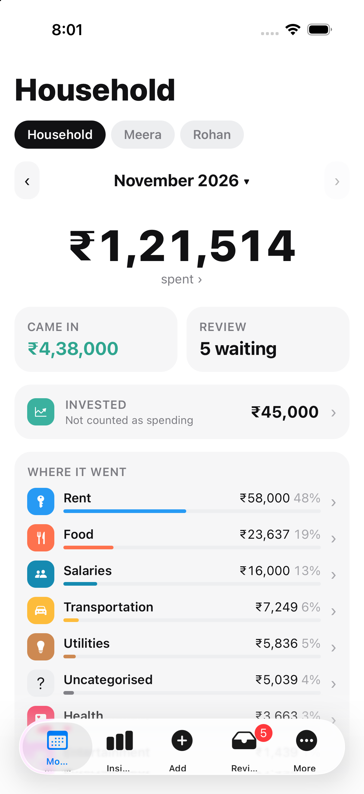
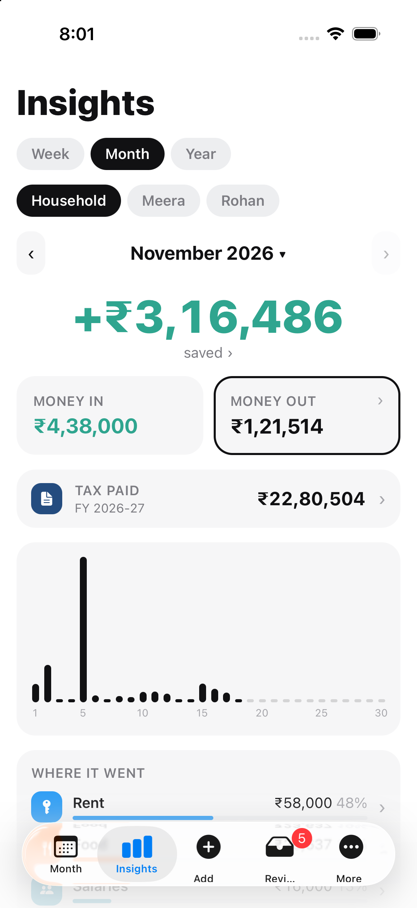
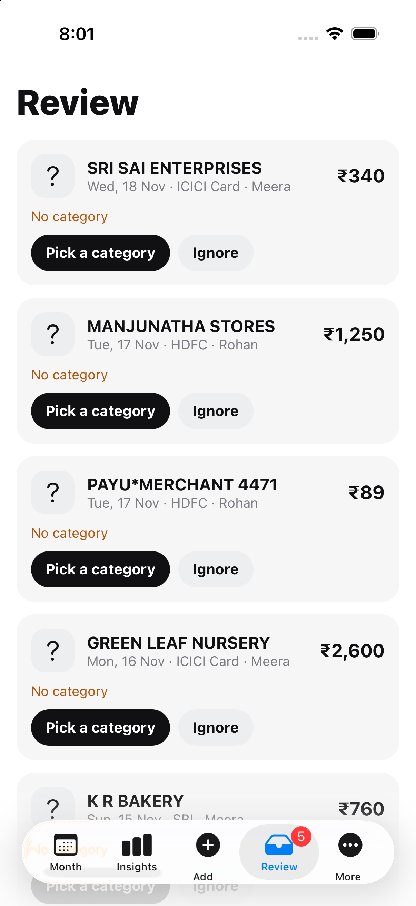
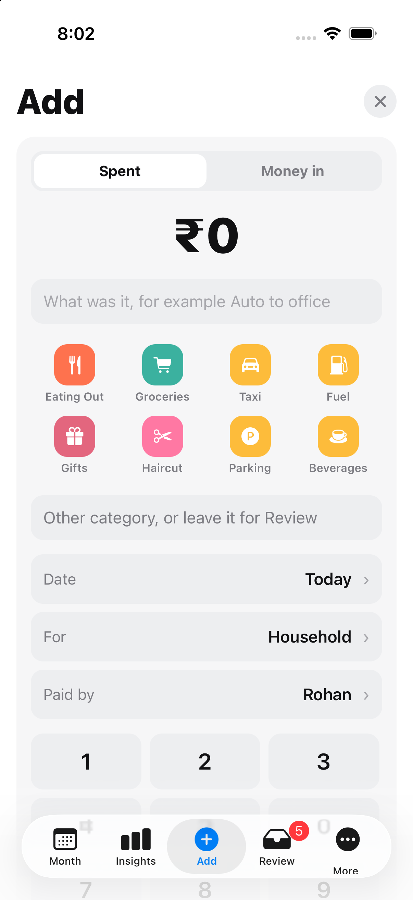

# Household Expense Tracker

A shared expense tracker for a two-person household. Bank texts, bank emails and card emails are read automatically, filed by rules, and anything unclear goes to a review queue. It runs as a website and as a phone app, on one database.

The screenshots below come from the built-in demo, which uses an invented household (Rohan and Meera). Every name, number and payment in this repository is made up.

<p>
  
  
  
  
</p>

## What it does

- Captures spending without typing. Bank SMS, bank emails and card emails are parsed with regular expressions (no LLM), so the same message always gives the same result.
- Files each payment by merchant rules and past history. Anything it is unsure about, or anything large, goes to Review instead of being booked.
- Treats money moving between the two people, or between their own accounts, as a transfer and not as spending or income.
- Tracks claimable spend (money spent for an employer that comes back), investments, tax paid, trips, tags, recurring payments and budgets.
- Sends a notification when the phone's payment reader switches off, so no payment is missed silently.
- Updates the phone app over the air, with a crash report endpoint for problems in the field.

## How it is built

- Website and API: Next.js on Vercel (`app/`, `lib/`, `middleware.ts`).
- Phone app: Expo and React Native with Expo Router (`native/`), iOS and Android. A small Android module reads payment screens and notifications (`native/modules/payment-readers`).
- Database: Postgres on Supabase. Migrations are numbered in `db/`.
- `lib/` holds the parsing patterns, the rules engine and the ingest logic, shared by the site and the app.
- A demo build (`EXPO_PUBLIC_VARIANT=demo`) runs on made-up data held on the phone and never reaches a database.

## Running the demo

```bash
cd native
npm ci
EXPO_PUBLIC_VARIANT=demo npx expo run:ios
```

This needs Node and Xcode. The real app also needs a Supabase project and the environment variables in `.env.example`.

## Notes on this copy

This is a cleaned copy of a private project. Personal names, phone numbers, account details, email addresses and finances were replaced with made-up ones, and the tests were left out because they were built from real bank messages. Some folder names and comments still show the original structure.
